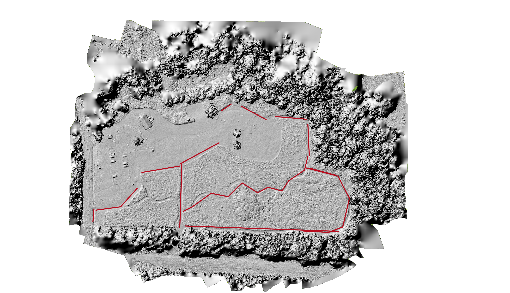
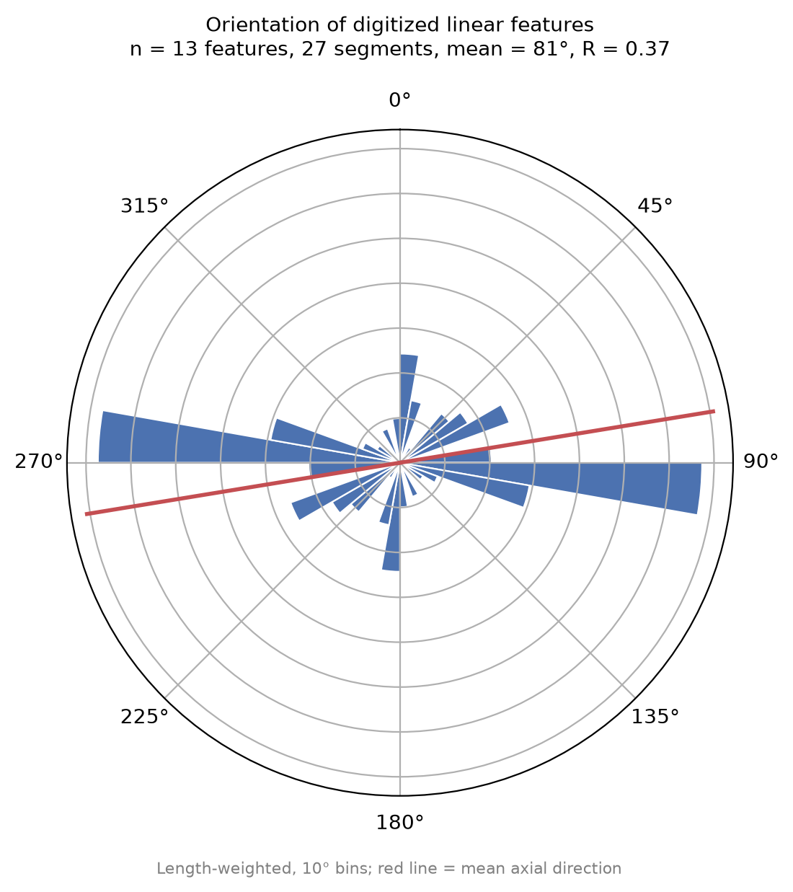

# SfM photogrammetry workflow: drone images → orthomosaic and DEM → GIS mapping → orientation analysis

A complete, reproducible workflow from raw drone photographs to quantitative directional data:
Structure-from-Motion (SfM) processing in Agisoft Metashape, mapping of linear features in QGIS,
and length-weighted circular statistics in Python.

The linear features mapped here (paths and field edges in a park) are a **workflow analogue**
for mapping directional landforms such as glacial striations, grooves or flutes on exhumed
glacial pavements.



## Data

Public sample dataset **odm_data_aukerman** from the OpenDroneMap project
(<https://github.com/OpenDroneMap/odm_data_aukerman>): 77 geotagged nadir drone photographs of
Aukerman Park, Ohio, USA. The raw images are not included in this repository.

## Workflow

| Step | Software | Settings | Output |
|---|---|---|---|
| 1. Photo alignment (SfM) | Agisoft Metashape Professional 2.3 | Accuracy: Medium; generic + reference preselection (EXIF GPS) | 77/77 images aligned, 58,235 tie points |
| 2. Dense reconstruction | Metashape | Depth maps: Medium quality, Mild filtering | Point cloud, 7.5 million points |
| 3. Digital elevation model | Metashape | Source: point cloud | DEM, 11.3 cm/pixel |
| 4. Orthomosaic | Metashape | Surface: DEM | Orthomosaic, 2.82 cm/pixel |
| 5. 3D model | Metashape | Height field, Medium face count | Mesh, 486,962 faces |
| 6. Export | Metashape | WGS 84 / UTM zone 17N (EPSG:32617) | GeoTIFF orthomosaic and DEM, OBJ model, processing report |
| 7. Hillshade | QGIS (GDAL) | Azimuth 315°, altitude 45°, Z factor 1 | Shaded relief that reveals subtle topography |
| 8. Digitizing | QGIS | LineString layer in a GeoPackage, field `type` | 13 linear features, 863 m in total |
| 9. Orientation analysis | Python | Segment azimuths, 0–180° axial data, length-weighted | Rose diagram and summary statistics |

## Orientation analysis

Each digitized line is split into straight segments. For every segment the azimuth is
calculated clockwise from north and folded to 0–180°, because a line has an orientation but
no direction (axial data). The mean orientation and the mean resultant length *R* are computed
by doubling the angles, averaging on the circle and halving the result (Mardia and Jupp, 2000),
with each segment weighted by its length. *R* ranges from 0 (no preferred orientation) to 1
(all features parallel).



| Group | Features | Segments | Total length (m) | Mean orientation (°) | R |
|---|---|---|---|---|---|
| All | 13 | 27 | 863.0 | 80.7 | 0.37 |

**Interpretation.** The rose diagram is **bimodal**: a dominant E–W mode (long paths and field
edges) and a secondary N–S mode (transverse paths). Because the two modes are roughly
orthogonal, they partly cancel, so *R* is low and the single mean orientation (81°) does not
describe the data well. This shows why the full distribution must be inspected rather than
only the mean. In glacial geomorphology, a bimodal pattern in striations or flutes can point
to more than one ice-flow phase, whereas a single ice-flow direction typically gives a high *R*.

## Repository contents

```
README.md
scripts/
    orientation_analysis.py        standalone version (geopandas)
    orientation_analysis_qgis.py   runs inside the QGIS Python Console, no installation needed
data/
    features.gpkg                  digitized linear features (EPSG:32617)
results/
    summary.csv                    circular statistics, overall and per type
    segments.csv                   one row per segment: length and azimuth
    features.csv                   one row per feature: length and start-to-end azimuth
figures/
    map_hillshade_features.png
    rose_diagram.png
```

## How to run

**Inside QGIS (no installation):** load `data/features.gpkg`, open *Plugins → Python Console*,
and run:

```python
exec(open(r"path/to/scripts/orientation_analysis_qgis.py", encoding="utf-8").read())
```

**Standalone Python:**

```bash
pip install geopandas matplotlib
python scripts/orientation_analysis.py data/features.gpkg --layer linear_features --out results
```

## Reference

Mardia, K. V. and Jupp, P. E. (2000). *Directional Statistics*. Wiley, Chichester.

## Author

Wajdi Allagui · ORCID [0009-0002-4603-2473](https://orcid.org/0009-0002-4603-2473)
